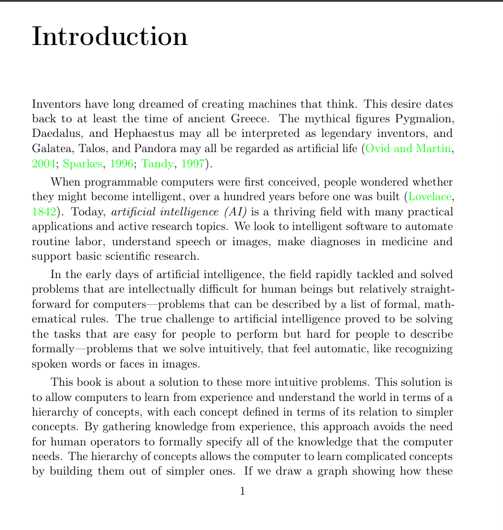
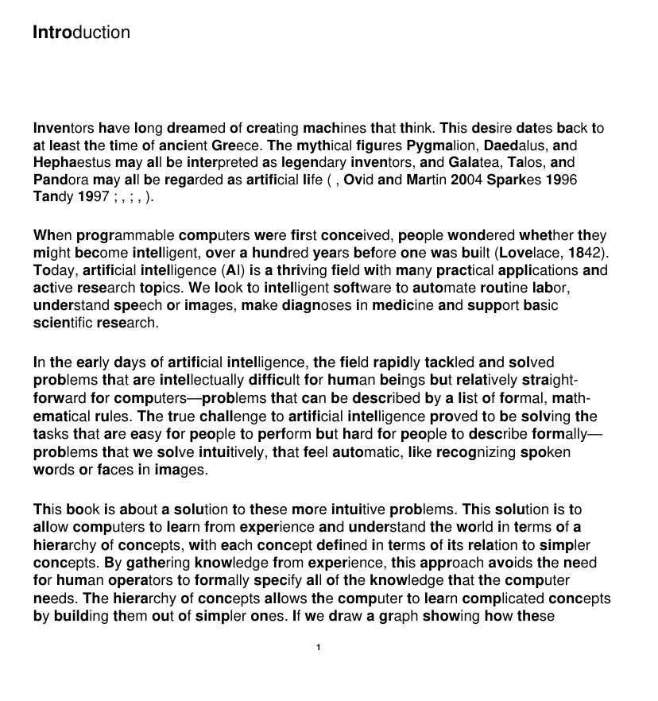
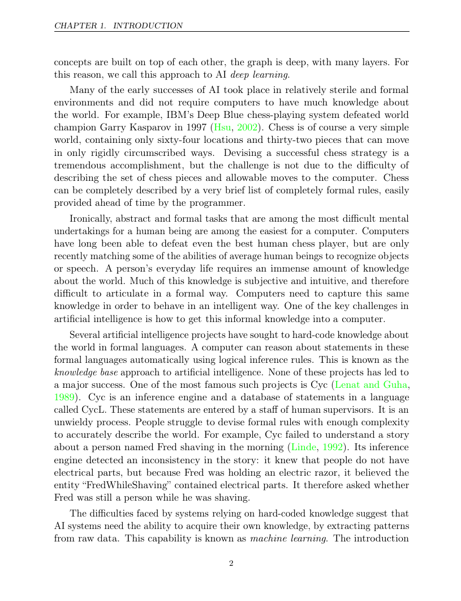
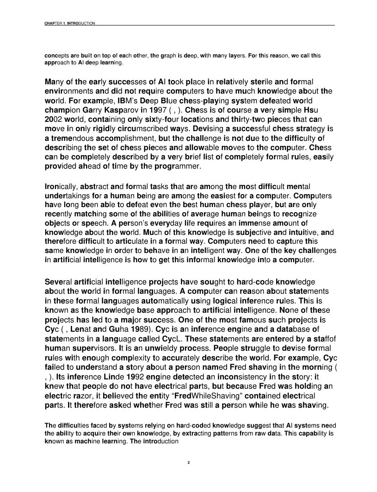

# PAB – Prefix-Anchor Bolding

**Convert any text, PDF, or image into a "bold-prefix" reading format, in one Colab notebook.**

[](https://colab.research.google.com/github/sajal-01/PAB-prefix-anchor-bolding-algorithm/blob/main/PAB_Bold_Reader_Colab.ipynb)
[](LICENSE)


PAB bolds the **leading letters of every word** so your eyes can anchor on the start of each word while your brain fills in the rest. The notebook reads your document page by page, applies the algorithm, and rebuilds a **single combined PDF** in which the original text is replaced by the bolded version.

---

## Table of contents

- [Example: before and after](#example-before-and-after)
- [Features](#features)
- [Quick start](#quick-start)
- [The PAB algorithm](#the-pab-algorithm)
- [How the notebook works](#how-the-notebook-works)
- [Supported inputs and outputs](#supported-inputs-and-outputs)
- [Limitations](#limitations)
- [Contributing](#contributing)
- [License](#license)

---

## Example: before and after

Left: the original page. Right: the same page after PAB conversion.

### Page 1

<table>
  <tr>
    <th align="center"></th>
    <th align="center"></th>
  </tr>
  <tr>
    <td width="50%"></td>
    <td width="50%"></td>
  </tr>
</table>

### Page 2

<table>
  <tr>
    <th align="center"></th>
    <th align="center"></th>
  </tr>
  <tr>
    <td width="50%"></td>
    <td width="50%"></td>
  </tr>
</table>

### Text-only example

| | Text |
|---|---|
| **Input** | A new hack can help people read books almost twice as fast. |
| **Output** | **A** **ne**w **ha**ck **ca**n **he**lp **peo**ple **re**ad **bo**oks **alm**ost **tw**ice **a**s **fa**st. |

---

## Features

- **Multiple input types:** text PDFs, scanned PDFs, images (PNG, JPG, BMP, TIFF, WEBP), `.txt` files, or pasted text.
- **Page-by-page processing:** every page is converted and the results are merged into one PDF.
- **Layout-preserving replacement:** for text PDFs, the original text is replaced in place, keeping position, font size, colour, and images.
- **Built-in OCR:** scanned pages and images are read with Tesseract.
- **Smart bolding:** the bold part is chosen so it forms a real word or common prefix whenever possible.
- **Extra outputs:** a Markdown file of the converted text (`**bold**` notation) alongside the PDF.
- **Zero local setup:** everything runs in Google Colab.

---

## Quick start

1. Click the **Open in Colab** badge at the top of this page.
2. Run the cells from top to bottom (**Runtime → Run all**).
3. When prompted, upload one or more files. To use pasted text instead, set `INPUT_MODE = "paste"` and edit `PASTED_TEXT` in the run cell.
4. Download the results:
   - `pab_converted.pdf`: the combined converted document
   - `pab_converted.md`: the converted text in Markdown

> Replace `REPO_NAME` in the Colab badge link with this repository's name.

---

## The PAB algorithm

PAB (Prefix-Anchor Bolding) decides, for every word, how many letters from the **left** should be bold. The bold run is always **continuous and starts at the first letter**. Punctuation, digits' separators, and apostrophe endings (such as the `'s` in *reader's*) are never bolded.

### Length table

| Word length | Letters bolded (from the left, always continuous) |
|---|---|
| 1 | 1 (whole word) |
| 2 | 1 |
| 3 | 2 |
| 4 | 2 |
| 5 | 2 or 3 |
| 6 | 3 |
| 7+ | 4 or 5 |

### Choosing between options

Where the table allows more than one value (5-letter words and words of 7+ letters):

1. Start with the **longest** allowed prefix.
2. If that prefix is a **common English word or common prefix**, use it. Examples: **high**lighted, **over**come, **words**mith.
3. Otherwise try the next shorter allowed prefix.
4. If none of the candidates is meaningful, fall back to a **length-based default**: 2 for 5-letter words, 4 for 7–8 letters, 5 for 9+ letters.

A meaningful bold prefix is preferred, but any valid result is accepted, so **every word is always bolded**.

### Pseudocode

```text
for each word in text:
    n = length(word)
    if n <= 2: bold first 1 letter
    else:
        (lo, hi) = allowed range for n        # 3→(2,2), 5→(2,3), 7+→(4,5) ...
        for k from hi down to lo:
            if word[:k] is a common word or prefix: bold first k letters; stop
        if nothing matched: bold default_length(n)
    leave punctuation and whitespace untouched
```

### Worked example

> **A** **ne**w **ha**ck, **wh**ich **i**s **be**ing **hai**led **a**s **a** **bles**sing **fo**r **peo**ple **wi**th **Atten**tion **Defi**cit **Hyper**activity **Diso**rder

---

## How the notebook works

```text
Upload / paste  →  Extract text  →  Apply PAB  →  Replace text on page  →  Merge pages  →  Combined PDF
```

| Step | What happens |
|---|---|
| **1. Install** | Installs PyMuPDF, Tesseract OCR, pytesseract, Pillow, ReportLab, and wordfreq. |
| **2. Algorithm** | Defines the PAB functions (`bold_length`, `pab_html`, `pab_markdown`). |
| **3. Extraction** | Text PDFs: native text blocks. Scanned PDFs and images: OCR blocks. |
| **4. Rendering** | Original text is covered and the bolded version is drawn in the same position; plain text is typeset with ReportLab. |
| **5. Run** | Processes every upload and merges all pages into one PDF. |
| **6. Preview and download** | Shows the first page and downloads the PDF and Markdown files. |

### Using the algorithm on its own

```python
print(pab_markdown("Reading faster with highlighted words"))
# **Read**ing **fas**ter **wi**th **high**lighted **wo**rds
```

---

## Supported inputs and outputs

| Input | Handling |
|---|---|
| Text PDF | Text replaced in place, layout and images preserved |
| Scanned PDF | Pages OCR'd, then rebuilt with bolded text |
| Image (`.png`, `.jpg`, `.jpeg`, `.bmp`, `.tiff`, `.webp`) | OCR, then converted to a PDF page |
| `.txt` file or pasted text | Typeset into a new PDF |

**Outputs:** `pab_converted.pdf` (combined document) and `pab_converted.md` (converted text).

---

## Limitations

- **Complex layouts** (multi-column pages, tables, text over images) may shift slightly, because bold letters are wider than regular ones.
- **OCR accuracy** depends on scan quality. Blurry or low-resolution inputs can produce recognition errors that carry into the output.
- **Scanned pages are rebuilt** from OCR text on a clean page, so the original scan image is not kept.
- **Language support:** the "meaningful prefix" check uses an English word list. Other languages still work, using the length-based rules only.
- **Effectiveness varies.** Bold-prefix formats help some readers and not others, and research on their benefits is mixed. This project provides a tool for experimentation, not a medical or educational claim.

---

## Contributing

This project is open source and contributions are welcome.

1. Fork the repository.
2. Create a feature branch: `git checkout -b feature/your-idea`
3. Commit your changes and open a pull request.

Ideas that would be especially useful:

- Word lists for additional languages
- Better handling of multi-column and table layouts
- Configurable bold ratios and styles
- A command-line version outside Colab

Bug reports and suggestions are welcome through the Issues tab.

---

## License

Released under the [MIT License](LICENSE). You are free to use, modify, and share this work, including in coursework and research, with attribution.

If you use PAB in a study or project, please cite the repository:

```text
Sajal. PAB – Prefix-Anchor Bolding. GitHub repository, https://github.com/sajal-01/REPO_NAME
```
